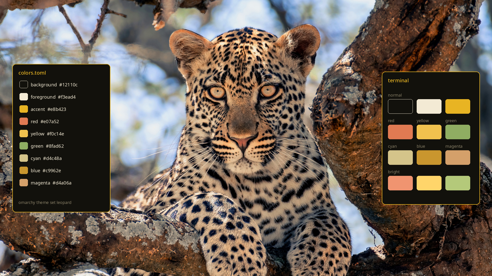
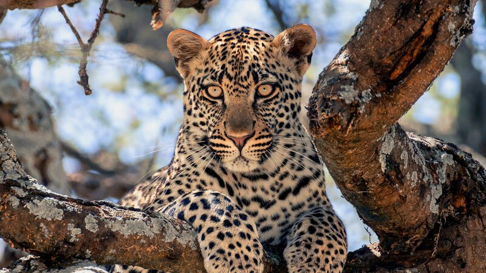
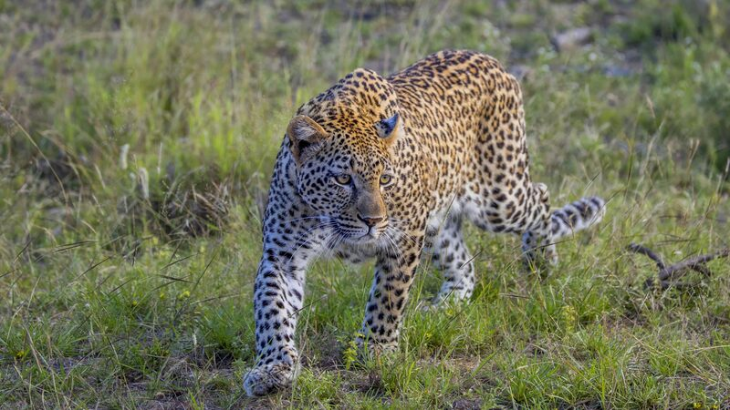
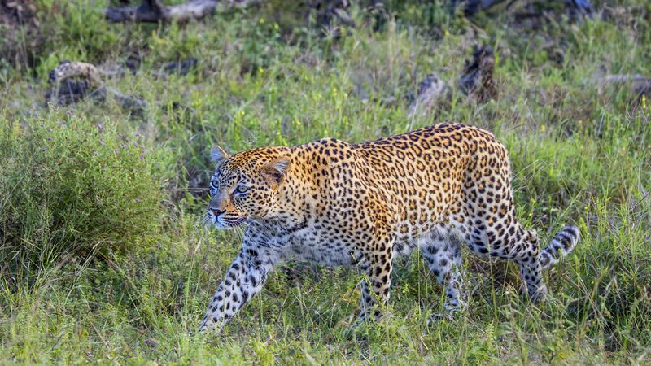
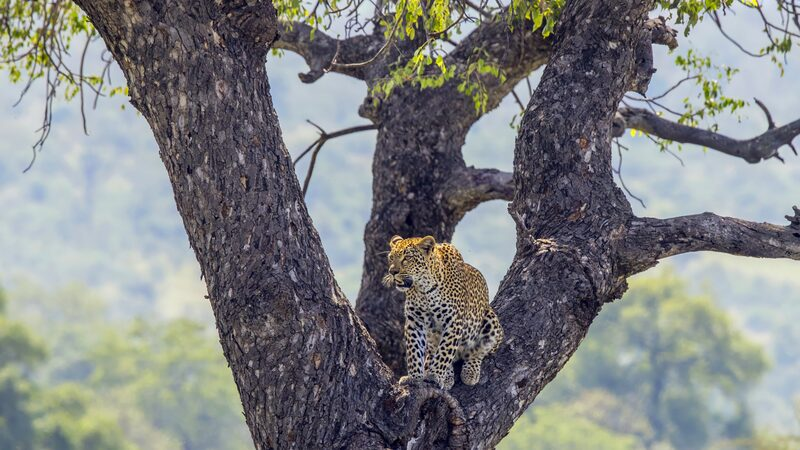
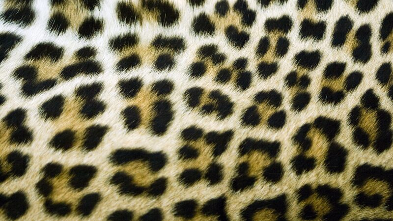
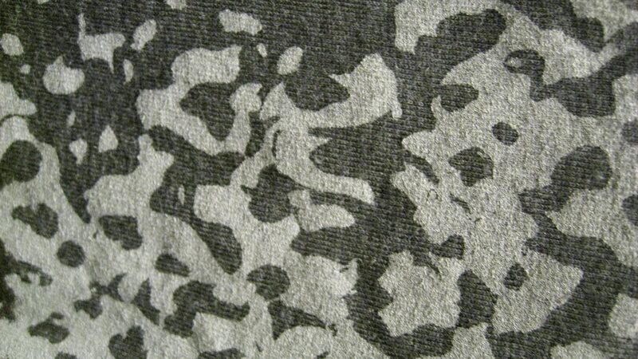

# Leopard



A dark [Omarchy](https://omarchy.org/) theme. The desk is near-black. The accent is the gold in a leopard's coat, with black for the spots, the borders, and the quiet parts of the screen. Four wallpapers are high-resolution photographs of leopards. Two are print photographs, one light and one dark, that fill the frame.

> [!NOTE]
> **Why the writing is cream, not yellow.** Gold is the accent: window borders, the selected row, and highlights. The sentences themselves stay a warm cream (`#f3ead4`) on near-black (`#12110c`). A full screen of yellow text is hard to read for long. Cream on black stays comfortable, and the gold still shows up where a colour should draw the eye.

## Palette

`colors.toml` is the whole scheme. Omarchy reads that one file and paints the terminal, Neovim, btop, the bar, and the other apps it knows how to theme. Each name is a job.

| Role | Colour | Job |
| --- | --- | --- |
| Background | `#12110c` | The desk. Near-black, warmed a little. |
| Foreground | `#f3ead4` | The writing. Warm cream. |
| Accent | `#e8b423` | Window border and the selected item. Coat gold. |
| Yellow | `#f0c14e` | Warnings and bright highlights. |
| Red | `#e07a52` | Errors. Warm, so it sits with the gold. |
| Green | `#8fad62` | Success. An olive, still clearly green. |
| Blue | `#c9962e` | A deeper gold, used where a theme would normally use blue. |

> [!TIP]
> **Install it from a git URL** once this folder is a repository:
>
> ```bash
> omarchy theme install https://github.com/<your-user>/omarchy-leopard-theme.git
> ```
>
> Omarchy names the theme from the repository: `omarchy-leopard-theme` becomes `leopard`. Apply it again later with `omarchy theme set leopard`.
>
> From this folder, without publishing it:
>
> ```bash
> ln -sfn "$PWD" ~/.config/omarchy/themes/leopard
> omarchy theme set leopard
> ```
>
> `icons.theme` selects the dark yellow Yaru icon set, so folder icons pick up the same gold.

## Window corners

> [!IMPORTANT]
> **Applying this theme sets the corner curve.** `hyprland.lua` in this folder is loaded with the colours. It sets `rounding = 8`, the corner radius in pixels. `0` is a sharp rectangle. `8` is a small curve. The cards in the picture above use that same curve.
>
> Your own `~/.config/hypr/looknfeel.lua` is loaded after the theme. A `rounding` line in that file would replace the theme's number. Leave it unset if you want the theme to own the corners.
>
> Omarchy ignores `hyprland.lua` only when a theme was cloned from a git repository. This folder is linked in as your own theme, so the file is kept. Check the live value with `hyprctl getoption decoration:rounding`.

## Wallpapers

Click a thumbnail to open the file at full size. Each file is **3840×2160**. The first four are the whole scene. The last two are print photographs that already fill the frame.

Cycle them with `omarchy theme bg next`.

### Serengeti tree

[](backgrounds/01-serengeti-tree.jpg)

A juvenile African leopard in Serengeti National Park, Tanzania.

### Kruger stalk

[](backgrounds/02-kruger-stalk.jpg)

Tatiana, a six-year-old female, in Kruger National Park.

### Kruger stride

[](backgrounds/03-kruger-stride.jpg)

An African leopard crossing open grass in Kruger.

### Tree fork

[](backgrounds/04-tree-fork.jpg)

A young female in a leadwood tree, Kruger.

### Light print

[](backgrounds/05-light-print.jpg)

A light coat pattern. The photograph already runs edge to edge.

### Dark print

[](backgrounds/06-dark-print.jpg)

A dark cloth print. Pale spots on a charcoal ground.

## Credits

The photographs are by their authors and stay under the licences below. Link the author and the licence if you share a picture on.

- [Juvenile in the Serengeti](https://commons.wikimedia.org/wiki/File:001_Juvenile_leopard_in_the_Serengeti_National_Park_Photo_by_Giles_Laurent.jpg) — Giles Laurent, [CC BY-SA 4.0](https://creativecommons.org/licenses/by-sa/4.0/)
- [Kruger stalk](https://commons.wikimedia.org/wiki/File:Leopard_(Panthera_pardus_pardus)_Kruger.jpg) — Charles J. Sharp, [CC BY-SA 4.0](https://creativecommons.org/licenses/by-sa/4.0/)
- [Kruger stride](https://commons.wikimedia.org/wiki/File:Leopard_(Panthera_pardus_pardus)_Kruger_2.jpg) — Charles J. Sharp, [CC BY-SA 4.0](https://creativecommons.org/licenses/by-sa/4.0/)
- [Tree fork](https://commons.wikimedia.org/wiki/File:Leopard_(Panthera_pardus_pardus)_young_female_Kruger_2.jpg) — Charles J. Sharp, [CC BY-SA 4.0](https://creativecommons.org/licenses/by-sa/4.0/)

The two prints are photographs from Flickr, both under [CC BY 2.0](https://creativecommons.org/licenses/by/2.0/):

- [Light print](https://www.flickr.com/photos/becker271/3554618621/) — Becker1999, *leopard pattern*
- [Dark print](https://www.flickr.com/photos/shaireproductions/4250185244/) — shaire productions, *Animal Print*

`scripts/make-wallpapers.sh` downloads the photographs and rebuilds the preview.
